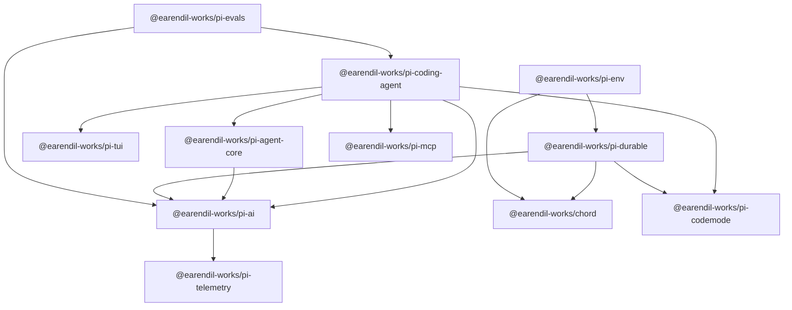
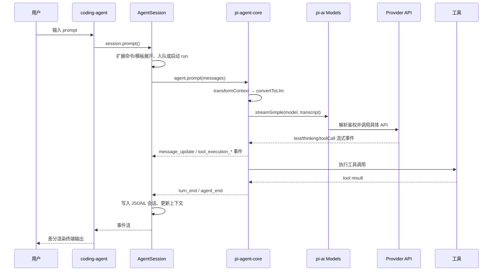

# Pi Code Wiki

本文档基于仓库当前源码生成，用于回答四个问题：

- Pi 是什么，仓库由哪些包组成。
- 每个包负责什么，核心类与函数在哪里。
- 包与包之间如何依赖，一次请求如何流经整个系统。
- 如何安装、构建、测试、运行、发布。

> 适用版本：`1.2.0`（各发布包版本一致）。源码入口以根目录 `package.json`、各包 `package.json` 与 `src/` 为准。

## 文档导航

| 文档 | 内容 |
|---|---|
| [01-overview.md](./01-overview.md) | 项目定位、仓库结构、包总览、技术栈、核心术语 |
| [02-architecture.md](./02-architecture.md) | 分层架构、依赖图、请求生命周期、会话与上下文、扩展机制 |
| [03-getting-started.md](./03-getting-started.md) | 安装、构建、测试、运行、模型数据、发布与 CI |
| [04-package-ai.md](./04-package-ai.md) | `@earendil-works/pi-ai`：多提供商 LLM 统一 API |
| [05-package-agent.md](./05-package-agent.md) | `@earendil-works/pi-agent-core`：Agent 循环与工具执行 |
| [06-package-coding-agent.md](./06-package-coding-agent.md) | `@earendil-works/pi-coding-agent`：CLI、会话、模式与扩展系统 |
| [07-package-tui.md](./07-package-tui.md) | `@earendil-works/pi-tui`：差分渲染终端 UI 库 |
| [08-package-durable.md](./08-package-durable.md) | `@earendil-works/pi-durable`：持久化会话、任务与文档运行时 |
| [09-package-chord.md](./09-package-chord.md) | `@earendil-works/chord`：契约、对象、热重载与 RPC 运行时 |
| [10-package-mcp.md](./10-package-mcp.md) | `@earendil-works/pi-mcp`：MCP 客户端 |
| [11-package-codemode.md](./11-package-codemode.md) | `@earendil-works/pi-codemode`：QuickJS 沙箱代码执行 |
| [12-package-env.md](./12-package-env.md) | `@earendil-works/pi-env`：SSH 远程执行环境 |
| [13-package-telemetry.md](./13-package-telemetry.md) | `@earendil-works/pi-telemetry`：厂商无关遥测契约 |
| [14-package-evals.md](./14-package-evals.md) | `@earendil-works/pi-evals`：行为评测与文档增益评测 |

## 10 分钟速览

Pi 是一个“最小内核 + 可扩展”的编码 Agent 运行时。它把模型调用、工具执行、会话存储和终端界面拆成独立包：

```text
用户界面层     coding-agent（Interactive / Print / JSON / RPC）
                 │
运行时层       AgentSession / AgentSessionRuntime / SessionManager
                 │
Agent 层       pi-agent-core（Agent、agent-loop、工具执行）
                 │
模型层         pi-ai（Provider、Models、流式事件、鉴权、成本）
                 │
基础设施       pi-tui / chord / durable / codemode / mcp / env / telemetry
```

包级依赖（只列内部包）：



一次交互式请求的主链路：



## 快速开始

```bash
npm install --ignore-scripts
npm run build
./pi-test.sh            # 从源码运行 pi
./test.sh               # 运行测试（隔离 HOME，未配置密钥时跳过联网用例）
```

Ubuntu/Debian 还需要 `libcairo2-dev libpango1.0-dev libjpeg-dev libgif-dev librsvg2-dev fd-find ripgrep` 等系统依赖（见 CI 配置）。

## 阅读建议

- 想理解产品行为：先读 [01-overview.md](./01-overview.md) 与 [02-architecture.md](./02-architecture.md)。
- 想改 CLI 或会话逻辑：读 [06-package-coding-agent.md](./06-package-coding-agent.md)。
- 想接入新模型提供商：读 [04-package-ai.md](./04-package-ai.md)。
- 想写扩展/工具：读 [06-package-coding-agent.md](./06-package-coding-agent.md) 的“扩展系统”与“内置工具”章节。
- 想做服务端持久化 Agent：读 [08-package-durable.md](./08-package-durable.md) 与 [09-package-chord.md](./09-package-chord.md)。
